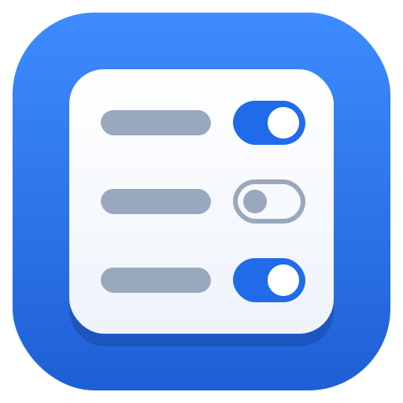
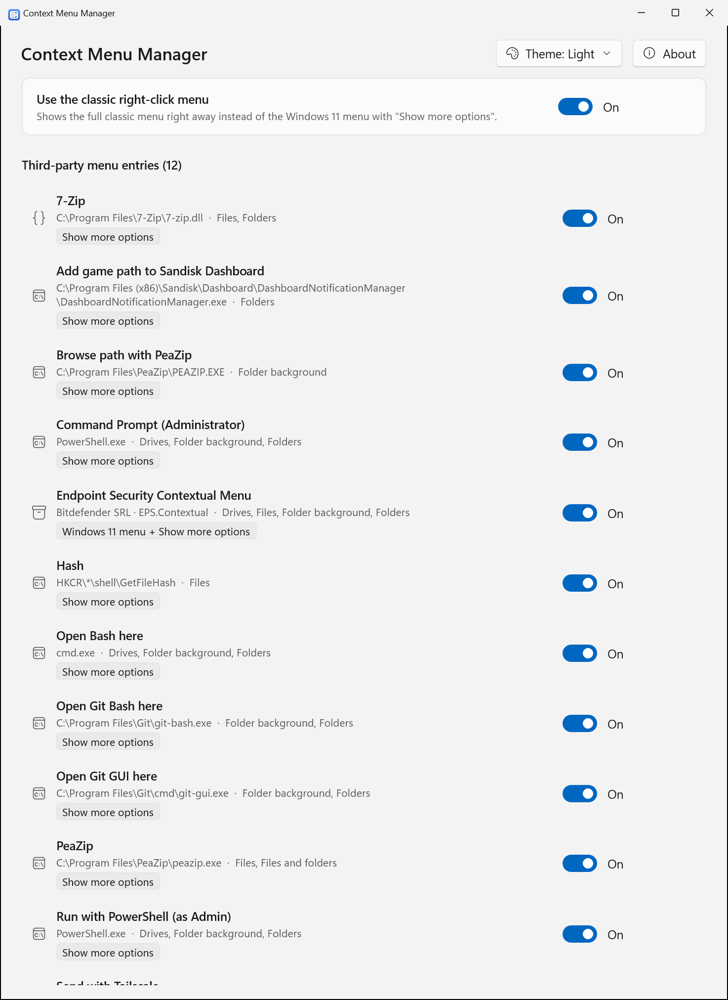

# Context Menu Manager



Turn third-party right-click menu entries on or off in Windows 11, in both the new menu and the classic menu.

App carefully directed by [Andy Rostad](https://github.com/arostad).  Released under the [MIT License](https://github.com/arostad/ContextMenuManager/blob/main/LICENSE).

<br clear="all">



## What it does

- **Classic menu by default.** One switch makes right-click open the full classic menu right away, instead of the Windows 11 menu with "Show more options" at the bottom. Switch it off to go back to the Windows 11 menu.
- **Third-party entries on or off.** Every entry added by other apps is listed with a switch, whether it lives in the Windows 11 menu, the classic menu, or both. Turn one off to hide it and turn it back on to bring it back.
- **Microsoft entries are left alone.** Entries that ship with Windows are not listed, so you can't break the built-in menu by accident.

## How it stays safe

- It only writes to your own user settings (HKEY_CURRENT_USER). It never needs admin rights and never touches system-wide settings.
- It blocks entries instead of deleting them. Turning an entry back on removes only what the app added, so the original registration is untouched.
- Before every change it saves a `.reg` backup to `%LOCALAPPDATA%\ContextMenuManager\backups`. The About window has a link that opens that folder.
- Changes show up in new Explorer windows. Restarting Explorer is offered as a button and only happens after you confirm.

## Requirements

Windows 11, x64.

## Build from source

Install the [.NET 10 SDK](https://dotnet.microsoft.com/download/dotnet/10.0), then run this from `src/ContextMenuManager`:

```
dotnet build -c Release -r win-x64
```

Visual Studio isn't needed. The Windows App SDK comes from NuGet and the app builds as a self-contained, unpackaged program.

## License

[MIT](LICENSE)
